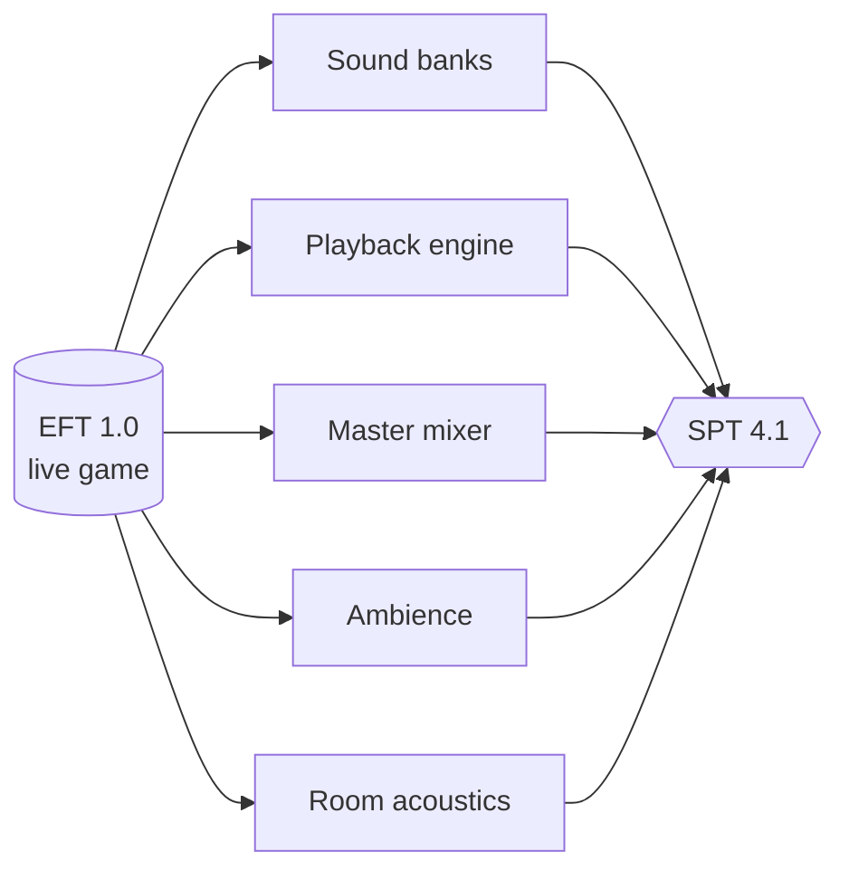
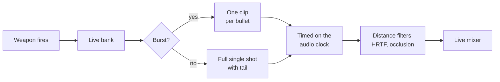
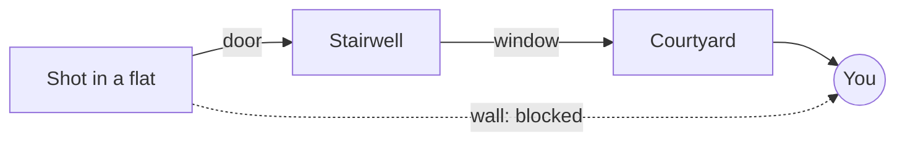

# SPT-SEB

**Sound Engine Backport: the EFT 1.0 sound engine, ported to SPT.**

SEB brings the live game's **sound banks** and the **code that plays them** into SPT. Guns, ambience and room acoustics sound like EFT 1.0.

> [!NOTE]
> Custom weapons (WTT-Armory…) keep their own sounds. Weapons that WTT-ContentBackport replaces (M4A1, HK416, PKM…) get the live sounds.

## At a glance

| | |
|---|---|
| 🔊 Audio clips imported | **5,648** |
| 🔫 Weapon sound players matched to live | **190** |
| 🌲 Map ambience sets | **8 maps**, plus rain, shelling, tripwire |
| 🎛️ Live master mixer | **95 objects** |
| 🚪 Room-to-room sound routes | **9 maps**, 203,022 room pairs |

## What is ported

| Module | What you get |
|---|---|
| **Sound banks** | The live gunshots for 190 weapons, loaded in the background |
| **Playback engine** | Each bullet plays its own clip. Bursts fade, single shots ring out |
| **Distance and range** | Live transition distances, ranges and pitch for every weapon |
| **Master mixer** | The live mixer, limiter and sound groups |
| **Spatialization** | Dynamic HRTF and live filters for front, behind, above, below |
| **Ambience** | Live wind, seasons, rain and shelling loops for 8 maps |
| **Acoustics per map** | The live sound routes between rooms, 9 maps |

### How a shot is played

## Acoustics per map

Tarkov doesn't let sound pass through walls. Each map is cut into **rooms** (a corridor, a flat, a stairwell, a courtyard). Rooms are joined by **openings**: doors, windows, stairs.

When something happens in another room, the game finds the easiest way through those openings. The longer and more closed the way, the more muffled the sound.

EFT 1.0 recomputed these ways for every map. SEB adapts them to SPT's maps.

**What it brings to the game:**

- Sounds that were fully muffled now **come through doors and stairs**.
- Shorter ways mean **clearer sounds** from nearby rooms.
- Fewer detours mean **a more believable layout** of what you hear.

Covered maps: Customs, Woods, Reserve, Shoreline, Interchange, Lighthouse, Ground Zero, Streets of Tarkov, The Lab. Factory and Labyrinth already match EFT 1.0.

If an SPT update changes a map, SEB falls back to SPT's own routes for it.

## Settings (F12)

Open the Configuration Manager with **F12**, section **Volume**. Changes apply immediately.

| Setting | Default | Controls |
|---|---|---|
| Raid volume | 0 dB | Master volume of the raid |
| Ambient volume | −4 dB | Background ambience |
| Gunshots volume | 0 dB | All gunshots |
| Handling volume | 0 dB | Reloads, magazines, fire selector |
| Explosions volume | 0 dB | Grenades and explosions |
| Character volume | 0 dB | Footsteps, gear, movement |
| Impacts volume | 0 dB | Bullet impacts |

## Installation

1. Download the latest archive from [Releases](../../releases) or SP-Mod.
2. Extract it at the root of your SPT folder. It adds `BepInEx/plugins/` and `SPT_Runtime/user/mods/`.
3. Start the server, then the game.

Requires SPT 4.1.x. About 1.4 GB of audio.

## Documentation

See the [technical documentation](docs/DOCUMENTATION.md): code layout, shot lifecycle, differences with SPT, all settings, diagnostics, build steps.

## License

[MIT](LICENSE)
