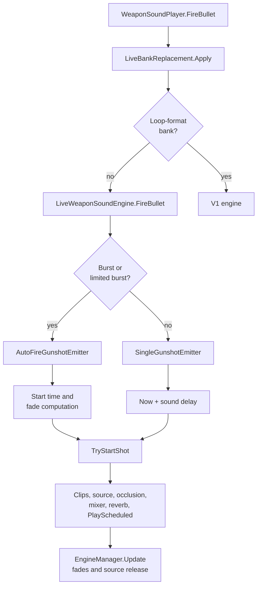

# Sound Engine Backport: technical documentation

This document describes the mod: what it does, how the code is organized and how it differs from stock SPT 4.1.6.

Reference versions: SPT 4.1.6 (EFT 0.16.9.5.40743, Unity 2022.3.43f1) and live 1.3.0.0.48484 (Unity 2022.3.43f2).

## Contents

1. [Overview](#1-overview)
2. [The problem](#2-the-problem)
3. [Repository layout](#3-repository-layout)
4. [Life of a shot](#4-life-of-a-shot)
5. [Client components](#5-client-components)
6. [Bundles](#6-bundles)
7. [Differences with stock SPT](#7-differences-with-stock-spt)
8. [Deliberate deviations from the live game](#8-deliberate-deviations-from-the-live-game)
9. [Configuration](#9-configuration)
10. [Diagnostics](#10-diagnostics)
11. [Building and regenerating](#11-building-and-regenerating)
12. [Particularities and limits](#12-particularities-and-limits)

## 1. Overview

The mod brings the live game's sound engine into SPT: the gunshot sounds and the way they are played, the live mixer, and the ambient sounds of each map. It has three parts:

| Part | Role |
|---|---|
| **Bundles** (`spt-mod/`) | 148 audio bundles from the live game (5,648 clips, about 1.4 GB), served to the client by the SPT server |
| **Server mod** (`server/`) | Registers the mod with SPT. Bundle loading is handled by SPT's `BundleLoader`, from `bundles.json` |
| **Client plugin** (`client/`) | Replaces `WeaponSoundPlayer`'s shot playback with a port of the live engine, installs the live mixer, and loads the live sound routes of 9 maps |

Since both sides use almost the same Unity version, the live bundles load in SPT. The live game is compiled with IL2CPP and SPT runs on Mono, so the live code can't be reused: the plugin reimplements it in C#. The reference is the decompiled live code.

## 2. The problem

SPT and the live game don't play a shot the same way.

| | SPT 4.1.6 | Live 1.3 |
|---|---|---|
| **Bank format** | One looping clip per burst, plus a tail | One isolated clip per bullet, reverb included, with several variants per distance layer |
| **Burst playback** | A loop runs during the burst, then the tail is scheduled when firing stops | Each bullet has its own source; the previous one fades out when the next one starts |
| **Bank storage** | Some in `audio/banks`, many in the weapon container | Same, but the distribution and content have changed |

Without the plugin, a live bank played by the SPT engine sounds wrong: doubled shots in semi-auto and silent bursts, because an isolated clip gets looped.

## 3. Repository layout

```text
client/                        BepInEx 5 plugin (netstandard2.1)
  SoundEngineBackportClient.dll
  live_mastermixer.bundle      Live mixer, loaded by the plugin
  acoustics/AudioBakeData/     Live rooms, portals and routes of 9 maps, in SPT's IDs (Git LFS),
                               each with its .scene check file
  src/Patches.cs               Entry point, configuration, Harmony patches, V1 engine
  src/LiveEngine/
    LiveWeaponSoundEngine.cs   Per-weapon engine and per-frame update
    GunshotEmitters.cs         Burst, single-shot and composite emitters
    ShotTiming.cs              Timing computations, no Unity dependency
    Schedulers.cs              Audio clock access for ShotTiming
    DynamicBetterSourcePool.cs Audio source pool per emitter
    LiveAudioMath.cs           Pitch, spatializer and filter blend, no Unity dependency
    LiveFilterBlend.cs         Applies that blend to shot sources
    LiveAudioData.cs           Live mixer, presets, limits and per-weapon range
    LiveMixerRouting.cs        Redirects scenes and sources to the live mixer
    LiveAmbientPort.cs         Live ambience fades, curves and sends
    LiveGroupPresetTable.cs    Sound group presets (generated)
    LiveOcclusionGate.cs       Live occlusion gate
    LiveOcclusionModule.cs     Optional extra muffling, disabled by default
    LiveBankReplacement.cs     On-the-fly bank replacement
    LiveBankTable.cs           Weapon to banks table (generated)
    LiveAcousticData.cs        Loads the transcribed bake data of the location
    EmitterTypes.cs            Shot settings and context
    Abstractions.cs            Interfaces
server/                        SPT 4 server mod (net10.0)
  SoundEngineBackport.dll
spt-mod/                       Bundles (Git LFS) and bundles.json
tools/extract_live_banks.py    Generates the extracted bundles and the table
tools/extract_live_mixer.py    Generates live_mastermixer.bundle
tools/extract_live_presets.py  Generates LiveGroupPresetTable.cs
tools/audit_live_coverage.py   Checks that the live sounds are shipped and selected (read-only)
tools/extract_live_acoustics.py Transcribes the live .audiobakedata into SPT's scenes
tools/check_live_acoustics.py  Checks the transcribed files against SPT's game (read-only)
docs/                          Technical documentation, live-acoustics-report.json
```

## 4. Life of a shot



The patch replaces `FireBullet` for every supported shot. If the patch throws, the error is logged and SPT's original code takes over.

Detailed sequence of a shot through the live engine:

1. **Banks.** `LiveBankReplacement` installs the weapon's live banks if they are ready.
2. **Fire mode.** A weapon goes to the burst emitter if it is automatic and set to `fullauto` or `burst`. Otherwise it goes to the single-shot emitter, even if it can fire bursts.
3. **Beat.** The interval between two shots comes from `FireRate` in bursts and `SingleFireRate` otherwise, with a 30 ms minimum.
4. **Delay.** It equals distance / 340.29 m/s in third person and 0 in first person.
5. **Clips.** `SoundBank.PickClipsByDistance` picks up to two clips and their mix according to distance and environment. If the layer is empty, the shot is not played.
6. **Source.** The pool provides a source, then the engine sets its position, range (live `AudioSettings` by environment and suppressor), occlusion, mixer group, two pitches, reverb, priority and filters.
7. **Playback.** The source starts with `PlayScheduled`, like `SuperAudioSample.PlayOn` in SPT.
8. **Supersonic sound.** `FireSonicSound` is still called as in SPT.

## 5. Client components

### Plugin and patches (`Patches.cs`)

| Harmony patch | Role |
|---|---|
| Prefix of `WeaponSoundPlayer.FireBullet` | Routes to the live engine or the V1 engine |
| Postfix of `WeaponSoundPlayer.Init` | Starts loading the weapon's live banks early |
| Prefix of `WeaponSoundPlayer.StopFiringLoop` | Closes the sequence (live) or lets the tail apply (loop) |
| Prefix of `WeaponSoundPlayer.OnDisable` | Closes the sequence; shots in flight finish playing |
| Postfix of `WeaponSoundPlayer.OnDestroy` | Puts the engine in shutdown |
| Postfix of `SpatialAudioOccluder.ApplyOcclusionToSource` | Removes the occlusion request of an unoccluded source and applies the optional module |
| Prefixes of `BetterSource.SetLowPassFilterParameters` and `SetHighPassFilterParameters` | For engine sources, turn these calls into an occlusion request |
| Prefix of `BetterAudio.CreateSoundManagers` | Installs the live mixer |
| Prefix of `BetterSource.CheckBinauralAllowed` | Blends HRTF like the live game on the relevant groups |
| Prefix of `BetterAudio.FindMixerGroup` | Translates `NonspatialBypass`, renamed on the live game |
| Postfix of `BetterAudio.ResetWorldMixerValues` | Resets the `World` bus to `RaidVolumeDb` |
| Prefix of `AmbientAudioSystem.Init` | Applies the live ambience values before the blenders start |
| Postfix of `SoundSettingsController.AdjustSoundValue` | Copies the general and hideout volumes to the live mixer |
| Postfixes of `GUISounds.method_11` and `SetHideoutLowPassFilter` | Copy the hideout fades to the live mixer |
| Postfix of the `SpatialAudioDataLoader` constructor | Finds the transcribed live file of the location and its `.scene` check |
| Prefix of `SpatialAudioDataLoader.LoadBakeDataAsync` | Checks the scene's rooms and portals, then gives the game the live file, or SPT's if the check fails |
| Postfix of `SpatialAudioDataLoader.DataLoadedHandler` | Logs what the game loaded |

`IsLegacyBank` classifies a bank as old if one of its clips contains `loop` (any case, some WTT-Armory clips have no underscore) without containing `tail`. The result is cached per bank, because reading clip names on every bullet would be costly.

### V1 engine

This engine serves banks that remain in loop format, for example on some WTT-Armory weapons. It keeps SPT's loop behavior, with a queue and a scheduled tail. One difference: SPT ends a salve only when the trigger is released, even in semi, so a 100 ms click played two beats of the loop for one bullet. Outside `fullauto` and `burst`, the V1 engine schedules the tail one beat after the shot, as SPT does for a trigger already released.

The loop is not cut on SPT's grid (`ClipLength / 16`) either. Many custom loops do not follow it: the KAC PDW loop holds 17.3 shots, and its silenced loop starts each shot about 18 ms before its grid line. The grid cut then lands inside a shot, up to full scale, while the tail starts around 0.2, and the queue does no crossfade. `LegacyLoopCuts` reads each loop clip once (`AudioClip.GetData`) and lists its gaps: the lowest point of a 3 ms envelope over ±25 ms, below 70 % of its peak. The cut ending the shot of a beat goes to the quietest gap from 0.65 beat before its grid line to 0.2 beat after it, not yet played. A single shot ends on the first beat (0.35 to 1.2 beats), a 2-round burst on the second, as in SPT (its second shot plays no sound of its own; up to 1.0.1 the V1 engine ended it on the first beat, so it sounded like a single shot). A salve ends on the beat SPT picks (the next grid line after the release); if that beat's gap and grid cut are both already past, the next shot is already playing and ends at its own gap rather than being cut at once (5 % of releases end more than a beat after the release this way). The grid cut, 15 ms before the beat, stays when no gap is found, when it is quieter, or when the clip can't be read. Gap times count in blocks of `frequency / 1000` frames (0.998 ms at 44.1 kHz), and the level a cut leaves is the peak of the millisecond before it. Over the 338 loop clips a V1 salve can play (WTT-Armory, the live RPD, M60 and silenced AA-12 loops, WTT-ContentBackport's), measured on the real samples, the peak left at the cut drops from 0.31 to 0.21 on single shots, from 0.33 to 0.22 on 2-round bursts and from 0.44 to 0.31 on salve ends. No loop gets worse, except 5 bursts by 0.02 to 0.04. `DebugLogs` writes each cut as a `[loop]` line.

The V1 engine can also play a bank of isolated clips if the live engine is disabled.

### Per-weapon engine (`LiveWeaponSoundEngine`)

There is one engine per `WeaponSoundPlayer`, created on the first shot. A single `MonoBehaviour`, `EngineManager`, updates them every frame.

When the weapon is destroyed, its engine enters shutdown: it keeps running until the sounds in progress end, 15 s at most, then releases its sources. If its update throws, the error is logged and the engine is dropped; the next shot creates a new one.

It also decides the mixer group using the live rule: the occluded group above an effect of 0.5 (`OcclusionThreshold`, identical on the 190 weapon prefabs). SPT uses 0.55. The value is copied into `_currentMixerGroup`, which keeps `IsOccludedToListener` correct for distant supersonic sounds.

### Emitters (`GunshotEmitters.cs`)

**`AutoFireGunshotEmitter`** plays bursts:

- If the time since the last shot exceeds 4 beats, a new burst begins: the shot starts immediately and the end of the previous burst keeps playing.
- Within a burst, the previous shot fades out when the next one starts.
- The fade lasts 4 beats, capped at 0.25 s and limited to what remains of the clip.
- `BetterSource.Stop(duration)` chains the fade and the stop in a single operation. SPT's fade only touches `source1` and `source2`: the two reverb sources of a `ReverbSuperSource` (stereo shots) therefore fade out separately, slightly shorter, instead of being cut off.

**`SingleGunshotEmitter`** plays single shots: the source starts after the sound delay and the clip plays to the end, with no fade.

**Clip ends.** Every source of a shot (the two layers and the two reverb sources) stops 2 ms before the end of its clip, through `SetScheduledEndTime`. At the last sample, resampling (clips at 44.1 kHz, output at 48 kHz, pitch other than 1) rereads the clip's first sample. Since 625 of the 916 measured live clips start at full scale, without this margin every close shot ended with a hard click, 1.4 s after the start for an AK. The 2 ms fall in the clips' trailing silence (46 ms median).

**`CompositeGunshotEmitter`** routes to one or the other according to the fire mode, and closes the sequence of the emitter it leaves.

A 2-round burst triggers only one `FireBullet` in the game: the engine therefore schedules the second shot one beat later.

### Timing (`ShotTiming.cs`, `Schedulers.cs`)

The start time of a burst shot is computed as follows:

```text
earliest = max(time the sound must be heard, now + margin)
margin   = max(10 ms, duration of one audio block)
latest   = earliest + max(30 ms, beat / 2)
start    = previous shot + beat, clamped between those two bounds
```

The first shot of a burst starts at the "earliest" time. `ShotTiming` has no Unity dependency, which allows testing it outside the game.

### Source pool (`DynamicBetterSourcePool`)

- Sources are borrowed from `BetterAudio` when one is needed.
- A free source is always preferred, then a new source as long as the limit is not reached.
- At the limit, the oldest source is cut. The limit is 32 sources in bursts and 16 for single shots, per weapon.
- After 2 s without a shot, free sources are returned to `BetterAudio`, with their original reverb setting.
- A source stays busy as long as its reverb sources are still playing.

### Filters and spatializer (`LiveFilterBlend`, `LiveAudioMath`)

The live game creates the `Gunshots` group with its own prefab, `AudioSourceSuperCustomSpatialBuiltinEQReverbPrefab`, which SPT doesn't have. Its direct source has no Meta XR component but a `SimpleUnitySpatializer`, which requests filtering according to the sound's position:

| Position | Low-pass | High-pass |
|---|---|---|
| In front | 22 kHz | 20 Hz |
| Behind | 15 kHz | 80 Hz (blended at 0.4) |
| Below | 10 kHz (blended at 0.8) | |
| Above | | 400 Hz |

The live game merges this request with the occlusion one: the lowest low-pass and the highest high-pass win, each with its Q factor. Without occlusion (effect ≤ 0.001), only the spatializer request remains.

The plugin reproduces this behavior on SPT's prefabs, without adding a component, for gunshots and grenades: every frame, it computes the request of each busy source. First-person shots are stereo and have no request.

### Occlusion (`LiveOcclusionModule`)

This module has no live equivalent: the cutoff computation and the gunshot occlusion curves are identical to SPT's. It is therefore disabled by default (`ExtraMuffleStrength = 0`) and remains available for those who prefer stronger muffling.

### Occlusion gate (`LiveOcclusionGate`)

For `CombinedSpatialAudioOccluder` occluders, the live game keeps a source muted and filtered at 20 Hz until the occlusion score is ready, then applies the first result at once. It does the same outside hearing range. In SPT, the source plays unfiltered during that time and is heard through walls.

SPT doesn't have the live `ScoreUpdated` flag: the plugin considers the score ready after the occluder's first `OnLateUpdate`.

### Group presets (`LiveGroupPresets`)

A postfix of `BetterAudio.LoadGroupPreset` applies the live distance and spread curves and occlusion radius to the 15 common groups. Volumes are only taken over with the live mixer: `Gunshots` and `Grenades` at 0.75, `Speech` at 0.7, `Voip` at 0.8 and `Weaponary` at 0.4. This 0.4 goes with the asset's +4 dB: `Weaponary` is compensated when `RaidVolumeDb` goes down, up to the maximum of 1.0 (reached at −4 dB). Since `BetterSource.SetBaseVolume` rereads the preset on every playback, the sliders of the `Volume` section (`Weaponary`, `Grenades`, `Character`, `Impacts`) apply to it live, with or without the live volumes. Source limits remain SPT's, because the shot engine keeps up to 32 sources per weapon.

### Dynamic HRTF (`LiveDynamicHrtf`)

SPT enables or disables a source's HRTF according to its distance. The live game keeps it enabled and blends it. On `Weaponary`, `Collisions`, `Windows` and `InteractiveObjects`, the plugin takes over this computation every frame, from distance, angle and height. Below 1.5 m, HRTF is 0. Other groups keep a fixed intensity, except `Gunshots` and `Grenades`, which stay on the simple spatializer.

### Mixer (`LiveMixer`)

SPT loads its mixer from `Resources`. The plugin replaces it with the live one just before `CreateSoundManagers`. Main audible differences:

| Topic | SPT | Live |
|---|---|---|
| `World` bus | 0 dB, with a reverb effect whose dry is at −2 dB | Without that effect. Level comes from the backend, unknown (+4 dB in the asset). The plugin uses `RaidVolumeDb`, 0 dB by default |
| `Master` limiter | −1 dB, attack 10, release 20 | 0 dB, attack 25, release 120 |
| `Gunshots` group volume | 1.0 | 0.75 |

The 0.75 volume is only applied with the live mixer. If the bundle is missing or incomplete, the error is logged and SPT keeps its mixer. This setting affects every sound in the game.

### Routing to the live mixer (`LiveMixerRouting`)

Replacing `BetterAudio.Master` is not enough: SPT's scenes directly reference the `resources.assets` mixer, and the ambience blender only sets `BetterAudio.Master`. The plugin therefore moves to the live group of the same name:

- the outputs of `AudioSource`s;
- the `AudioMixerGroup` fields of `MonoBehaviour`s, found by reflection.

The sweep happens when the mixer is installed, on every scene load and in `AmbientAudioSystem.Init`. The `Master`, `InGame`, `Inventory`, `Music`, `UI` and `Chat` groups stay on SPT's mixer, because `GUISounds` uses them outside raids. Other mods' mixers are not touched.

### A single Meta XR reverb

Room reverb comes from the native Meta XR plugin: the `Meta XR Audio Reflection` effect mixes a shared reverb computed from spatialized sources. It therefore goes through neither `WorldVolume` nor `AmbientVolume`. SPT puts this effect as an insert on its `InGame` group, the live game in a separate `MetaXRAudioReflection` group. With both mixers loaded, two instances would run on a single shared reverb, which the plugin isn't designed to handle. A single instance is therefore safer.

The live mixer bundle thus keeps this effect bypassed (`tools/extract_live_mixer.py`, `--patch` option for an existing bundle). At installation, the live mixer's output is routed to SPT's `InGame` group: as in SPT, all sounds go through the single remaining instance, and SPT's mixer stays active. `MasterVolume` is no longer copied onto the live mixer (set to 0 dB): SPT's `Master` applies it once, with its −1 dB compressor after the live one. If SPT's `InGame` group can't be found, the log says so and the live mixer plays without Meta XR reverb.

### `World` bus high-pass

The live `World` group carries a resonant FMOD high-pass at 10 Hz, absent from SPT's `World`. On the low rumble of indoor room tones (`amb_indoor_tone_industrial` in the Reserve hangar), it produced short bursts of white noise, about 4 per second, aligned with the rumble's peaks. The clip itself has nothing above 2 kHz (−88 dB). The same room tone sent to SPT's `AmbientIn`, or muted, no longer produces bursts. The bundle therefore keeps this high-pass bypassed, with the same `--patch` option. At 10 Hz, it only removed infrasound.

### Ambience (`LiveAmbientPort`)

Before the blenders start, the plugin takes over the live `level397` values: 0.8 s fade to outdoors, 0.3 s transition to indoors, volume and occlusion curves, a speed of 2 for indoor rain, and 3 effect sends muted indoors.

SPT's indoor rain clips are much louder than the live ones: their volume is reduced by 8.4 dB (light), 20.6 dB (medium) and 17.8 dB (heavy). With a headset, rain also takes the value of the live templates. The ambience send and the compressors remain SPT's: with a headset every sound goes through the compressors, and their live gain made the game too quiet.

The live depth multiplier (4) is not taken over: SPT's job ignores portals beyond their depth, and the value would jump at that limit.

### Rooms, portals and routes (`LiveAcousticData`)

Each map's `*_Sound` scene splits the level into audio rooms (`SpatialAudioRoom`) joined by portals (`SpatialAudioPortal`, `UniversalTriggerSpatialAudioPortal`, `MultiWindowPortal`): doors, windows, stairs, openings. A sound heard from another room goes through the cheapest of the precomputed routes between the two rooms, and the portals on the way muffle it. These routes are baked offline into `StreamingAssets/AudioBakeData/<map>.audiobakedata`: for each pair of rooms, the routes as lists of portal IDs, their cost and length. The file format is the same in SPT 4.1.6 and live 1.3.

The live file can't be copied: room and portal IDs are renumbered at each bake, so the same ID points at another room in SPT's scene. `tools/extract_live_acoustics.py` therefore transcribes it:

1. It reads the active rooms and portals of the `*_Sound` scene on both sides, the ones `FindObjectsOfType` registers. The live game is IL2CPP: its components are decoded raw, following the field order of the live dump (the live `SpatialAudioRoom` serializes `roomConnections`, SPT's doesn't).
2. It pairs each live room and portal with the SPT one at the same place (5 cm), or with the one of the same name within 1 m. Rooms are placed by their game object first: on Streets, the volume of 43 outdoor rooms is 75 m higher on the live game, at the same place. A portal left over that is the only one between the same two rooms on both sides, within 3 m, is paired too.
3. It translates every live room pair whose two rooms and all portals have an SPT equivalent, and checks each route against the portal connections of SPT's scene (`_connectedRooms`): every portal must open on the room the route is in.
4. In the written file, these pairs replace SPT's. Every other pair keeps SPT's routes, so no pair of the SPT file is lost. A translated pair also keeps the SPT routes that go through an opening the live scene doesn't have, or that opens on other rooms there: on Streets the live game splits the outdoor zones, and a window that leads to `City_SW_01_CommonOutdoor` in SPT leads to a smaller zone on the live game, so the live routes between that flat and the outdoor room skip it (176 m instead of 13.5 m). A pair that would exceed the buffers SPT allocates for the location (`maxRoutesCount` and `maxRoutePortalsCount` of its `SpatialAudioLocationInfo`) keeps SPT's routes too.
5. It reads the file back and checks it: every room and portal exists in SPT's scene, the room lists cover each pair once, the maxima stay within SPT's buffers. A route that the live routes and SPT's kept routes share is written once.
6. It writes `<file>.scene` next to the file: the size and SHA-256 of the SPT bake it started from, and the ID and world position of every room and portal the file uses.

The method was checked on the maps that did not change: on Labyrinth and Factory, all the live pairs translate (1,195 and 5,480) and give exactly SPT's routes. Every live route is also valid in the live scene, and every SPT route in SPT's scene, except in 11 pairs of Customs.

| Map | Bake | Rooms paired | Portals paired | Live pairs translated | Changed | Added | With SPT routes kept | Kept from SPT | File |
|---|---|---|---|---|---|---|---|---|---|
| Customs | `custom_sound` | 336/337 | 1,015/1,027 | 15,305/17,453 | 12,254 | 11 | 6,723 | 2,386 | shipped |
| Factory | `factory_sound_rework` | 115/115 | 289/289 | 5,480/5,480 | 0 | 0 | 0 | 77 | SPT's, same routes |
| Ground Zero | `sandbox_sound` | 207/214 | 534/573 | 2,928/6,115 | 1,747 | 10 | 912 | 3,716 | shipped |
| Interchange | `shopping_mall_sound` | 232/346 | 799/1,121 | 5,667/14,447 | 3,429 | 24 | 739 | 5,000 | shipped |
| Labyrinth | `labyrinth_sound` | 77/77 | 97/97 | 1,195/1,195 | 0 | 0 | 0 | 10 | SPT's, same routes |
| Lighthouse | `lighthouse_sound` | 267/335 | 817/981 | 9,349/17,215 | 8,810 | 278 | 815 | 3,693 | shipped |
| Reserve | `reserve_sound` | 511/548 | 1,207/1,313 | 49,429/66,164 | 30,205 | 355 | 7,012 | 17,514 | shipped |
| Shoreline | `shoreline_sound` | 515/544 | 1,813/1,877 | 51,966/54,288 | 31,494 | 25 | 864 | 97 | shipped |
| Streets of Tarkov | `city_sound` | 1,049/1,085 | 2,931/3,158 | 54,101/111,531 | 29,299 | 1,205 | 18,496 | 55,232 | shipped |
| The Lab | `laboratory_sound` | 211/213 | 468/471 | 6,109/6,282 | 1,132 | 13 | 0 | 24 | shipped |
| Woods | `woods_sound` | 116/119 | 313/332 | 1,493/1,816 | 500 | 26 | 3 | 232 | shipped |

"Changed" pairs have other routes or costs on the live game: the live bake drops long detours, adds others and recomputes costs. "Added" pairs have no routes in SPT's file: without a pair, the game gives the sound the maximum occlusion (score 1). "With SPT routes kept" counts the translated pairs completed as described in step 4. On Lighthouse the live bake keeps half as many routes (268,000 against 565,000): in 1,696 pairs the shortest route left is more than 2 m longer, although all its openings exist on the live game. This is the live game's choice and it is kept. The live pairs that can't be translated go through rooms or portals that only exist on the live game: Interchange, Lighthouse and Streets were reworked. `factory_sound` (old Factory) is the same file in both games. The full figures, including why each pair was not translated, are in `docs/live-acoustics-report.json`.

The plugin changes only the path given to `SpatialAudioDataLoader`, and only after a check. The game first registers the rooms and portals of the loaded scenes, then reads the bake file. Between the two, the plugin looks up every room and portal listed in `<file>.scene` among those the game registered: each must exist, at its listed position within 5 cm. If one is missing or elsewhere, the raid uses SPT's own file and the log names the first differences. A file without its `.scene` is never used, and if this patch doesn't run, the game keeps SPT's path. The game files are not modified.

The routes are thus only used on the scene they were built for, whatever the version of the mod. They don't need to be generated again when the plugin changes. They need it when SPT changes the `*_Sound` scene of a map, which the check reports in the log (`the scene doesn't match`), or to take a newer live bake. A changed SPT bake with an unchanged scene only gives a warning: the file stays valid, but the pairs it keeps from SPT come from the old bake.

All the propagation calculators SPT creates (`ParallelSoundPropagationCalculator`) evaluate every route of a pair and keep the cheapest: the order of the routes and their baked cost (`HeuristicCost`) don't change the result. The baked cost is only read by `SoundPropagationCalculator`, which SPT never creates. The bake settings stored at the end of the file are SPT's (the game doesn't read them), and the propagation depth still comes from SPT's location info.

**Meta XR maps and geometry.** The `.xramap` (precomputed reflections, probes in world space) and `.xrageo` (meshes for the reflection ray tracing) files are not imported. They are baked from the meshes, not from IDs, and the meshes differ: of the 565 geometry files of SPT's `StreamingAssets/Acoustics`, 278 are identical on the live game and 287 hold another mesh (other vertex and triangle counts, from a tenth to 26 times as many vertices: Streets buildings got interiors, Lab rooms were simplified). Loaded in SPT, they would reflect walls that SPT's scenes don't have. SPT's files already match its meshes.

### Bank replacement (`LiveBankReplacement`, `LiveBankTable`)

For each weapon listed in `LiveBankTable`, the plugin:

1. loads the required bundles through `IEasyAssets.Retain`, in the background;
2. meanwhile continues with the current banks, rather than leaving the weapon silent;
3. replaces the banks once ready, never in the middle of a running loop.

The weapon is identified by the file name of its container. For an underbarrel launcher, the launcher's container counts, not that of the rifle in hand. The bundles stay loaded for the whole session, because spare weapons in the game's pools keep references to their banks. If a bundle fails, the error is logged and the weapon keeps its bank.

## 6. Bundles

| Folder under `audio/` | Content | Bundles |
|---|---|---|
| `banks/` | Original live banks, byte-identical to the live game | 40 |
| `banks/live_embedded/` | Banks extracted from live weapon and launcher containers | 39 |
| `blendoptions/` | Transition distances between layers | 1 |
| Others (`weapons/`, `audioshot`, casing sounds…) | Clips and related sounds, identical to the live game | 57 |
| `data/soundcontainers/` | Ambient sounds per map (wind, seasons), rain, artillery shelling, tripwire. Copied unchanged from the live game: same CAB as SPT's, so they replace SPT's at the same key | 11 |

### Map sound containers

The 11 bundles of `data/soundcontainers/` are copied from the live game without modification. They have the same CAB as SPT's and no dependency, so they replace SPT's at the same key, the way the original banks do. They are not produced by `extract_live_banks.py`: after a live update, copy them again from `StreamingAssets/Windows/assets/content/audio/data/soundcontainers` and add any new key to `bundles.json`.

| Bundle | Size | Difference with SPT |
|---|---|---|
| `artilleryshellingsounds` | 0.6 MB | 11 clips. Mono compressed whistles instead of stereo PCM. `mortarShots` volume 0.35 (SPT: 0.7) |
| `precipitationsoundstorageso` | 6.7 MB | 9 rain clips, shorter loops (`amb_rain_indoor_weak`: 11 s, SPT: 30 s) |
| `tripwiresoundstorage` | 1 MB | 4 clips: longer grenade fuses, and the defuse loop |
| 8 `…seasonambientsounddata` (City, Customs, Lighthouse, Reserve, Sandbox, ShoppingMall, Shoreline, Woods) | 66 to 78 MB each | 12 wind loops per map, re-edited and shorter. Lighthouse uses `openspace` winds where SPT uses `forest` ones |

### Why extract banks

The live game stores many banks in the weapon container. These containers can't be used as is: most share the same internal identifier (CAB) as SPT's, which makes Unity refuse the second load, and they also contain the model and animations.

`tools/extract_live_banks.py` therefore creates bundles that contain only what is needed: the `Body` and `BodySilenced` banks, their clips, the `SoundBank` script and a rewritten preload table. The CAB is new and the audio resource file is rebuilt with only the kept clips.

### Why WTT-ContentBackport is involved

WTT-ContentBackport replaces weapon containers (M4A1, HK416, PKM…) with versions that embed their own banks. These banks mask the mod's, and some remained in loop format. This is why the table also covers its weapons.

### Which weapon uses what

`LiveBankTable.cs` lists 77 weapons present in the live manifest whose played bank differs from the live one. The other live weapons already use the right bank. Weapons absent from the live game, like those of WTT-Armory, are not listed and keep their banks.

## 7. Differences with stock SPT

### Burst sound

| Topic | SPT 4.1.6 | This mod |
|---|---|---|
| Playback | A single loop during the burst | One source and one clip per bullet |
| End of burst | Tail scheduled at stop, aligned with the loop's rhythm | The last clip plays to the end |
| Transition between shots | None, the loop is continuous | Fade of the previous shot, 0.25 s at most |
| Pitch | One value, ±3 % around 1 | One value per clip layer, ±1.5 %, rises by 5 % as the magazine empties, bounded between 0.98 and 1.03 |
| End-of-burst detection | `BreakLoop` event and `_isFiring` state | Pause of more than 4 beats |
| Sources used | 2 per burst | As many as needed, 32 at most per weapon |

### Single-shot sound

| Topic | SPT 4.1.6 | This mod |
|---|---|---|
| Playback | Clip through the queue | Isolated clip on a free source |
| Close shots | In the same queue | Shots overlap, each plays to the end |
| Automatic weapon set to semi | Stays on burst logic | Switches to single-shot |

### Banks and distances

| Topic | SPT 4.1.6 | This mod |
|---|---|---|
| Variants | Often 1 clip per layer | Often 8 clips per layer |
| Transitions, standard weapons | 5, 30, 55, 100 m | 5, 40, 60, 100 m |
| Transitions, suppressed weapons | 5, 30, 55, 100 m | 5, 40, 180, 300 m |
| Distant suppressed shot | Silent beyond 100 m | Provided up to 300 m by the live setting |
| Sound range | Bank `Rolloff` | 600 m outdoors, 200 m indoors; suppressed: 300 m and 120 m |
| `Gunshots` group curves | SPT's | Live distance and spread |
| WTT-ContentBackport weapons | Banks embedded by WTT | Live banks when they exist |

### Occlusion and reverb

| Topic | SPT 4.1.6 | This mod |
|---|---|---|
| Source before occlusion is computed | Plays unfiltered | Muted until the first result |
| Occluded mixer group | Above an effect of 0.55 | Above 0.5 |
| Muffling | Occlusion computation alone | Same computation, blended with the spatializer |
| Mixer | SPT's | The live game's |
| Sound routes between rooms | SPT's bake | Live bake transcribed into SPT's rooms and portals, SPT's routes where the live data can't apply (9 maps) |
| Reverb | Source default setting | Live rule: active in first person and indoors, off for outdoor third-person shots |

### Unchanged

SPT's occlusion computation, the Meta XR acoustic maps and geometry, supersonic sounds and handling sounds remain the game's. Clip selection remains that of `SoundBank.PickClipsByDistance`.

## 8. Deliberate deviations from the live game

| Topic | Live | This mod | Reason |
|---|---|---|---|
| Shot start | Rounded to the next beat | Kept between two bounds, without jumps | On SPT, shots arrive aligned to frames and audio blocks. Rounding caused 92 ms of delay on the first first-person shot and gaps in bursts |
| Burst source limit | 15 | 32 | A shot occupies its source during the sound's travel, and 15 is no longer enough for long distant bursts |
| Extra muffling | Doesn't exist | Adjustable module, disabled by default | Comfort setting, tuned by ear |
| Shot source components | Dedicated prefab, no Meta XR on the direct sound | SPT's prefab, Meta XR inactive on the direct sound | SPT doesn't have this prefab; its preset already disables Meta spatialization there |
| `LimitRadius` and similar bank fields | Used to limit impact sounds | Ignored | SPT uses its own fixed values. They don't concern gunshots |

## 9. Configuration

File: `BepInEx/config/red.soundenginebackport.cfg` (`red.soundenginebackport.client.cfg` up to 1.0.0, moved on first start). Settings are also available from the Configuration Manager (F12).

Only the `Volume` section is visible by default. Everything else is marked `IsAdvanced` and only appears with "Advanced settings" ticked.

| Section | Key | Default | Effect |
|---|---|---|---|
| Volume | `RaidVolumeDb` | `0` | Level of the live mixer's `World` bus (all raid sounds), from −12 to +6 dB. The live game receives it from its server; +4 is the asset default. No effect without the live mixer. Applied live |
| Volume | `AmbientVolumeDb` | `-4` | Level of the ambience alone, with or without a headset, from −20 to +6 dB. Chosen by ear, not a live value. Applied live |
| Volume | `GunshotsVolumeDb` | `0` | Gain of all gunshots, applied by the engine on every shot (live engine and V1 path). Applied live |
| Volume | `HandlingVolumeDb` | `0` | Gain of the `Weaponary` preset, after the `World` bus compensation, from −20 to +2.5 dB. Volume capped at 1.0 |
| Volume | `ExplosionsVolumeDb` | `0` | Gain of the `Grenades` preset, from −20 to +2.5 dB. Volume capped at 1.0 |
| Volume | `CharacterVolumeDb` | `0` | Gain of the `Character` preset (footsteps, gear), from −20 to +2.5 dB. Volume capped at 1.0 |
| Volume | `ImpactsVolumeDb` | `0` | Gain of the `Impacts` preset, from −20 to +2.5 dB. Volume capped at 1.0 |
| Engine | `LiveEngineEnabled` | `true` | Enables the live engine. Read on every shot |
| Engine | `PreferLiveBanks` | `true` | Gives weapons in the table their live banks. Weapons already processed keep their state |
| Engine | `SequenceResetBeats` | `4` | Pause, in beats, that ends a burst |
| Engine | `BurstFadeBeats` | `4` | Fade between shots, in beats, capped at 0.25 s |
| Engine | `AdaptiveFadeEnabled` | `true` | Lengthens the fade when a shot is scheduled far ahead, within the cap |
| Engine | `LiveReverbRouting` | `true` | Applies the live reverb rule |
| Engine | `LiveMixerEnabled` | `true` | Uses the live mixer. Affects all sounds. Read at game start |
| Engine | `LiveSpatializerEnabled` | `true` | Filters third-person shots and grenades according to their position. Read when sources are created |
| Engine | `LiveGroupPresetsEnabled` | `true` | Live curves, occlusion radius and HRTF for all groups, volumes with the live mixer. Read at game start |
| Occlusion | `LiveOcclusionGateEnabled` | `true` | Source muted until its occlusion is known and outside hearing range |
| Occlusion | `SpectatorListenerRoomEnabled` | `true` | While a spectator camera (Fika) is away from the local player's body, the listener's room follows the camera instead of the body, so occlusion keeps running. The player the camera is attached to is heard unobstructed |
| Occlusion | `ExtraMuffleStrength` | `0` | Added muffling, absent from the live game: 0 = like live, 1 = maximum |
| Occlusion | `MinMuffleCutoffHz` | `500` | Lowest cutoff reached by the module |
| Engine | `LiveAmbientPortEnabled` | `true` | Live ambience values: blender fades and curves, indoor rain level and speed, effect sends muted indoors. Read at raid start |
| Engine | `LiveDynamicHrtfEnabled` | `true` | Live HRTF blend, recomputed every frame. Applied live |
| Engine | `LiveAcousticDataEnabled` | `true` | Live sound routes between the rooms of each map, from `acoustics/AudioBakeData`. Read at raid start |
| Debug | `DebugLogs` | `false` | Detailed log of every shot |
| Debug | `RecordKey` | `F10` | Records the next 10 s of the game's output to `BepInEx/seb_record_<time>.wav` |

### Slider caps per category

Unity doesn't play a source above a volume of 1.0 (100 %). The `Weapon handling`, `Explosions`, `Footsteps and gear` and `Bullet impacts` sliders multiply the volume of their group's preset, and the result is capped at 1.0. A boost therefore only has an effect as long as that cap is not reached.

| Group | Volume at 0 dB | Headroom before 1.0 |
|---|---|---|
| `Grenades`, `Character`, `Impacts` | 0.75 (EFT 1.0) | +2.5 dB (0.75 × 1.33 ≈ 1.0) |
| `Weaponary` | 0.4 × `World` bus compensation: 0.63 with `RaidVolumeDb` at 0 | +4 dB with `RaidVolumeDb` at 0, none at −4 dB or lower |

The common cap is therefore set to +2.5 dB: the first three groups reach it exactly, and `Weapon handling` stays effective over its whole range as long as `RaidVolumeDb` doesn't go below −1.5 dB. Below that, the bus compensation has already brought this group close to the maximum, and the top of the slider changes nothing.

Without the EFT 1.0 mixer, the groups keep SPT 4.1.6's volumes, and the real headroom may differ.

`Gunshots` is not concerned: its gain is applied per shot in the engine, and it keeps a range of −20 to +6 dB.

## 10. Diagnostics

With `DebugLogs = true`, `BepInEx/LogOutput.log` contains:

| Tag | Meaning |
|---|---|
| `[shot]` | Shot received: bank, first person, mode, distance, delay, beat, pitch, environment |
| `[sched]` | Shot started: lag (`lag`), clips, mix, occlusion, mixer, reverb, pool size |
| `[shot-silent]` | No clip at this distance: normal for a suppressed bank beyond its range |
| `[shot-lost]` | No source available |
| `[bank]` | Banks replaced for a weapon |
| `[fire]` | Shot handled by the V1 engine |
| `[occl]` | Sample of an applied muffling (1 in 200) |

These messages are always visible, even without `DebugLogs`:

| Message | Meaning |
|---|---|
| `could not load the live banks of ...` | Bundle refused: its weapons keep their bank |
| `FireBullet patch failed` | Exception in the patch: the shot falls back to SPT's code |
| `[mixer-state]` | With `DebugLogs`: mixer values and rain sources at every room change |
| `[headset]` | Headset model applied and rain level |
| `live mixer routing: ...` | Number of live groups and references moved when the mixer is installed |
| `live mixer has no group ...` | A group stays on SPT's mixer, for lack of an equivalent |
| `engine tick failed` | Exception in the update: the engine is dropped then recreated on the next shot |
| `[acoustics] <map>: EFT 1.0 routes, scene check passed (...)` | The scene matches, the game reads the transcribed file |
| `[acoustics] <map>: EFT 1.0 routes loaded in ... s: ...` | What the game loaded: room pairs, routes, portal steps, rooms reachable from another room, portals of the scene |
| `[acoustics] <map>: SPT 4.1.6 routes (no EFT 1.0 file for this map)` | Factory, Labyrinth, Hideout and the maps without a transcribed file |
| `[acoustics] <map>: SPT 4.1.6 routes (LiveAcousticDataEnabled is off)` | The setting is off |
| `[acoustics] <map>: the scene doesn't match the EFT 1.0 routes (...)` | Warning. Rooms or portals missing or moved: SPT's file is used. Regenerate the files |
| `[acoustics] <map>: SPT's own bake changed since ...` | Warning. The scene still matches and the file is used |
| `[acoustics] <map>: ... route steps point at a portal the scene doesn't have` | Warning. Should never appear after a passed check |
| `[acoustics] <map>: ... .scene is missing` | Warning. The file can't be checked and is not used |

The SPT server reads `bundles.json` at startup: after adding a bundle, restart it.

**Recording an audio defect.** `RecordKey` (F10) writes the next 10 s of what the player hears, after all mixers, as a 32-bit float WAV at the output rate. This is what made it possible to find the end-of-shot click and the room tone bursts: comparing the recording to the decoded clips (correlation alignment, samples, spectrum) says more than listening tests.

## 11. Building and regenerating

### Client and server

```bash
export SptGame=/path/to/SPT
export SptServer=/path/to/SPT/SPT_Runtime
(cd client && dotnet build -c Release)
(cd server && dotnet build -c Release)
```

### Timing tests

`ShotTiming.cs` and `LiveAudioMath.cs` compile on their own in a console project, without Unity. No test project is kept in the repository for now.

### Mixer

```bash
python3 tools/extract_live_mixer.py \
  --live "<live>/EscapeFromTarkov_Data/StreamingAssets/Windows" \
  --out client/live_mastermixer.bundle
```

### Rooms, portals and routes

This requires both installations, UnityPy, TypeTreeGeneratorAPI and numpy. The SPT scenes are read with type trees generated from SPT's assemblies; the live ones are decoded raw. It takes about 3 minutes:

```bash
python3 tools/extract_live_acoustics.py \
  --live "<live game folder>" \
  --spt "<SPT>" \
  --out client/acoustics \
  --report docs/live-acoustics-report.json
```

The output is deterministic. A map whose live routes change nothing is not written (and an old file is removed). Then run the independent check, which reads the files the way the game does and exits with 1 on any problem:

```bash
python3 tools/check_live_acoustics.py --spt "<SPT>" --data client/acoustics
```

It checks the format and the indices the propagation job reads, that every room and portal is an active object of SPT's scene, that every new route goes through doors joining the rooms it crosses, that no SPT pair is lost, and that the `.scene` files match the installed SPT bake and scene. It was tested with broken files (unknown portal, reversed route, lost pair, moved portal): each one fails. Copy `client/acoustics` next to the plugin DLL. The live raw decoding follows the 1.3 field order: after a live update, check the room and portal fields in the dump again. The script stops on any inconsistency it finds when reading the files back.

### Coverage audit

`tools/audit_live_coverage.py` is read-only. It checks that `bundles.json`, the files on disk and the table agree, that every shipped live bundle is byte-identical to the live one, that each live weapon container plays the live clips (names and sizes, per role, with the mod's bundles loaded in place of SPT's), and, with `--log`, that the banks logged as `[bank] <container>` match the table. It exits with 1 when it finds a problem. Run it after every regeneration and every live update. `--skip-weapons` runs the checks that do not need UnityPy.

```bash
python3 tools/audit_live_coverage.py \
  --live "<live>/EscapeFromTarkov_Data/StreamingAssets/Windows" \
  --spt "<SPT>/EscapeFromTarkov_Data/StreamingAssets/Windows" \
  --spt-mods "<SPT>/SPT_Runtime/user/mods" \
  --mod spt-mod \
  --table client/src/LiveEngine/LiveBankTable.cs \
  --log "<SPT>/BepInEx/LogOutput.log"
```

`[bank]` lines only appear with `LogShotDetails` on, and only for weapons of the table.

### Bundles and table

This requires a live installation, UnityPy, and WTT-ContentBackport installed so that its weapons are compared:

```bash
python3 tools/extract_live_banks.py \
  --live "<live>/EscapeFromTarkov_Data/StreamingAssets/Windows" \
  --spt "<SPT>/EscapeFromTarkov_Data/StreamingAssets/Windows" \
  --spt-mods "<SPT>/SPT_Runtime/user/mods" \
  --mod spt-mod \
  --table client/src/LiveEngine/LiveBankTable.cs
```

The tool compares the live weapon containers with those of SPT and WTT-ContentBackport, then writes the extracted bundles, `blendoptions`, `bundles.json` and `LiveBankTable.cs`. Each bundle is reread and checked: identical rewrite of objects before modification, valid references and decodable clips.

## 12. Particularities and limits

- **M4A1:** its live shots are cut from the recording of the old loop. The resemblance to the old sound is normal.
- **AA-12 suppressed bank:** it remains in loop format, even on the live game, and goes through the V1 engine.
- **WTT-Armory weapons:** they keep their banks, including loop format for some.
- **Metal impacts:** the `metal_thick` bank from WTT-ContentBackport carries to 200 m, against 100 to 130 m for other surfaces.
- **`weapons/generic` bundle:** it also differs from the live game but is not replaced, because its clips are referenced by SPT's containers.
- **Prefabs loaded after the mixer:** `resources.assets` prefabs loaded after the mixer is installed, like the BTR radio, are not moved by the routing sweep.
- **Map data:** the rooms, portals and routes come from the live game only for the pairs of rooms whose rooms and portals all exist in SPT's scene; the others keep SPT's routes, see [Rooms, portals and routes](#rooms-portals-and-routes-liveacousticdata). The rooms and portals themselves (position, size, door state) are SPT's scene objects. The Meta XR acoustic maps and geometry (`.xramap`, `.xrageo`) stay SPT's: they are baked from meshes that differ on the live game.
- **Live sounds not imported:** 420 other live audio bundles that SPT also has are not shipped. 373 of them (voices, phrases, item and movement sounds) are identical to SPT's in clips and data. 47 differ: breath clips of the `voice/` bundles, the `phrases/` bundles (the live ones hold more clips), `prefabs/items/itemdropsounds` (299 live-only clips), `prefabs/movement`, `prefabs/character/firstpersonplayerhearingsettings` (12 live-only `infection_dissonance` clips), `itemsounds`, the zombie voices, and the `vodka` and `weap_handon` clips. Four live bundles have no equivalent in SPT or in WTT: `phrases/bear_07_den_voice`, `phrases/bossscourge_voice`, `startmission/introanim/introanimsoundlibrary` and `tapes/tapessoundbank`. The audit reports which weapon-related bundles are not shipped.
- **Live backend settings:** `OcclusionSettings`, `AudioGroupPresets`, `CustomHeadphonesTemplates`, `MasterMixerSettings` and `Weapon.AudioSettings` come from the live server. The mod uses the values from the client assets.
- **Live version:** the content depends on version 1.3.0.0.48484. After a live update, rerun the tools in `tools/` and check the decompiled behavior again.
